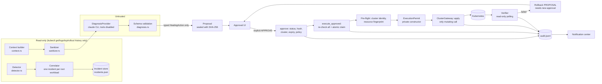

# Self-Healing

Self-Healing detects Kubernetes problems, optionally asks an AI model to diagnose them, and turns the
diagnosis into a typed **proposal**. An administrator reviews the proposal and must explicitly approve it.
Only then does a deterministic Rust executor apply the change, and it verifies the result afterwards.

**There is no autonomous mode.** No detector, AI response, policy, notification or background task can
change the cluster. There is no flag that turns autonomous mutation on.

## Architecture



### Code map

| Area | File |
|---|---|
| Domain types, closed `HealingAction` enum | `src-tauri/src/healing/model.rs` |
| State machine | `healing/state_machine.rs` |
| Detection and correlation | `healing/detector.rs` |
| Read-only cluster reader, snapshot | `healing/reader.rs` |
| AI context, redaction | `healing/context.rs`, `healing/sanitizer.rs` |
| Provider abstraction, claude CLI provider | `healing/provider.rs` |
| Diagnosis schema and validation | `healing/diagnosis.rs` |
| Analyze orchestration, caching | `healing/analysis.rs` |
| Proposal hashing | `healing/proposal.rs` |
| Policy | `healing/policy.rs` |
| Approval, execution, verification, rollback | `healing/service.rs`, `healing/verifier.rs`, `healing/rollback.rs` |
| The only mutating code (kubectl via existing commands) | `healing/gateway.rs` (`KubectlGateway::apply`) |
| Audit trail, notifications | `healing/audit.rs`, `healing/notify.rs` |
| Tauri commands | `src-tauri/src/commands/healing.rs` |
| UI | `src/pages/SelfHealingPage.tsx`, `src/components/healing/*` |

## Detection

Detection is deterministic and runs when the Self-Healing page scans: on open, every 60 s by default, or
when you click "Scan now". It runs three `kubectl get -A -o json` calls (workloads, nodes, Warning events)
plus `helm list`, and never calls AI.

| Code | Rule |
|---|---|
| `CrashLoopBackOff` | container waiting reason |
| `OOMKilled` | current or last termination reason |
| `ImagePullBackOff`, `ErrImagePull`, `InvalidImageName`, `CreateContainerConfigError` | container waiting reason |
| `PodPending` | Pending for more than 5 min, with the scheduling reason |
| `PodFailed` | phase Failed (e.g. Evicted) |
| `ExcessiveRestarts` | 5 or more restarts (not already CrashLoopBackOff) |
| `ReadinessProbeFailed`, `LivenessProbeFailed` | `Unhealthy` Warning events |
| `RolloutStuck` | Deployment `Progressing=False / ProgressDeadlineExceeded` |
| `UnavailableReplicas` | Deployment, StatefulSet or DaemonSet unavailable replicas |
| `ReplicaSetFailure` | `ReplicaFailure=True` (e.g. quota) |
| `JobFailed` | Job `Failed=True` |
| `NodeNotReady` | Node `Ready` not True |
| `WarningEvent:<reason>` | Warning events seen at least 3 times (attach to incidents; never create one alone) |
| `HelmReleaseFailed` | release status `failed` or `pending-*` |

**Correlation.** Findings are walked up controller ownerReferences (Pod → ReplicaSet → Deployment,
StatefulSet, DaemonSet, Job), so three CrashLooping pods of `payment-api` become one
`Deployment/payment-api` incident with three affected pods. Repeated scans update the open incident
with the same key (`context/namespace/kind/name`) instead of creating duplicates.

## AI diagnosis

- **Off by default.** Enable it in Self-Healing → Settings. Runs only when you click **Analyze** or
  **Re-analyze**.
- **Provider.** The local `claude` CLI is run as:

  ```
  claude -p --output-format json --json-schema <schema> --tools "" --restricted
         --strict-mcp-config --no-session-persistence --system-prompt <...> --max-budget-usd <cap>
  ```

  It runs from an empty temporary directory and uses your existing Claude Code login. With no tools, the
  model cannot run commands or read files.
- **Abstraction.** `DiagnosisProvider` (`name`, `diagnose(system, prompt, schema)`). To add Anthropic API,
  Bedrock or a local LLM, implement the trait and extend `ProviderKind`. API keys for such providers
  belong in the macOS Keychain, never in `ai.json` or logs.
- **Output.** Strict JSON schema (`summary`, `probable_root_cause`, `confidence`, `evidence[]`,
  `contributing_factors[]`, `recommended_action`, `risk_level`, `expected_impact`, `verification_steps[]`,
  `rollback_strategy`, `limitations[]`, `uncertainty`). Validation rejects:
  - unknown fields;
  - confidence outside 0–1;
  - empty evidence, or evidence that doesn't mention any observed resource or symptom;
  - actions that don't parse into the closed `HealingAction` enum (unknown fields such as `command` are
    rejected too).
- **Unsupported or unrelated actions** set the incident to MANUAL_INTERVENTION_REQUIRED. The diagnosis is
  kept for the operator.
- **AI unavailable** (disabled, CLI missing, not logged in, timeout, invalid output): the incident returns
  to DETECTED with "AI diagnosis unavailable". Everything else in the app keeps working.
- **Cost control.** A diagnosis is cached by an evidence key (symptoms, affected resources, restart
  bucket). Analyze reuses it; Re-analyze forces a new call. There is a per-call `--max-budget-usd` cap.
- **Confidence is informational only.** 99% still requires approval.

## Secret redaction (`sanitizer.rs`)

Applied to every object and text that leaves the machine:

- Secret `data`/`stringData` values are replaced with `[REDACTED]`. Secrets are never fetched for context;
  only names of referenced Secrets are listed.
- `metadata.managedFields` is removed. The `kubectl.kubernetes.io/last-applied-configuration` annotation
  is redacted.
- Env entries whose name looks sensitive (password, secret, token, api key, access key, private key,
  credential, auth, session, cookie, dsn, connection string) are redacted.
- Free text is scrubbed of: PEM private keys and certificates, `scheme://user:password@`, Bearer and Basic
  tokens, JWTs, AWS access keys, `key=value` / `"key": "value"` pairs with sensitive keys, and long mixed
  opaque tokens. Pure hex (image digests) is kept.

Use **Load evidence** in an incident to see exactly what would be sent.

## Supported actions and risk

| Action | Base risk | Executes via |
|---|---|---|
| `RESTART_POD` (controller-owned pods only) | LOW | existing `delete_resource` |
| `ROLLOUT_RESTART` (Deployment, StatefulSet, DaemonSet) | MEDIUM | existing `restart_resource` |
| `ROLLBACK_DEPLOYMENT` | HIGH | existing `rollback_rollout` |
| `SCALE_DEPLOYMENT`, `SCALE_STATEFULSET` (1..maxReplicas) | HIGH | existing `scale_resource` |
| `PATCH_WORKLOAD` (see below) | HIGH | `kubectl patch --type strategic` with the sealed patch |

### PATCH_WORKLOAD

Changes **only** these fields of **one named container** (plus the pod's grace period):

- liveness / readiness / startup probe timings and thresholds — a new `startupProbe` reuses the
  liveness handler; AI never supplies a probe command or URL;
- CPU / memory requests and limits (validated quantities, ≤ 64 cores / 256Gi, request ≤ limit);
- `terminationGracePeriodSeconds` (≤ 3600) and a simple preStop `sleep N` (≤ 600, < grace period);
- image tag within the container's current repository.

The AI returns typed values (`WorkloadPatch`, `deny_unknown_fields`); the backend builds the
strategic-merge patch from the live object (`healing/patch.rs`). At proposal time the patch is checked
with `kubectl patch --dry-run=server` (validated and admitted by the API server, nothing persisted) and
the per-field before → after diff is shown. A rejected dry run blocks the proposal. The exact patch is
stored in the proposal (covered by the SHA-256 hash) and is what executes after approval. Rollback for
Deployments: back to the pre-change revision (new approval).

## Discuss with AI

Each incident has a chat panel using the same sanitized context as Analyze. Operator messages are
redacted before storage/sending; history is kept with the incident and audited (`CHAT_EXCHANGE`).
The AI may attach a typed **suggested fix** and a **GitOps suggestion** (Helm values/manifest change to
commit yourself). Chat never changes the cluster or the incident status. "Create proposal for approval"
is a separate explicit step that validates the suggestion (related resource, allow-list, dry run) and
creates a PENDING_APPROVAL proposal — which still needs APPROVE HEALING.

## Claude Code authorization

AI calls use the local `claude` CLI either with the machine's own login (`CLI_LOGIN`, default) or with a
long-lived token from `claude setup-token` stored in the macOS Keychain (`KEYCHAIN_TOKEN`). The token is
passed only via the child process environment (`CLAUDE_CODE_OAUTH_TOKEN`), never logged, saved to
files, or returned to the UI. "Test authentication" makes one minimal call (haiku, $0.05 cap).

- A proposal's risk is `max(AI-declared risk, base risk)`.
- CRITICAL actions are never executable ("Manual intervention required", no approve button).
- Not supported: namespace, cluster, PV or PVC deletion; RBAC changes; CRD deletion; node deletion or
  drain; Secret replacement; Helm mutation; arbitrary patch or apply. Anything not in the enum is rejected.
- Names must be RFC 1123, so a name can never be read as a kubectl flag. Arguments are passed as argv
  arrays and never through a shell.

## Approval workflow and security model

States:

```
DETECTED → ANALYZING → PROPOSAL_READY → PENDING_APPROVAL → APPROVED → EXECUTING → VERIFYING → HEALED
```

Branches:

- PENDING_APPROVAL → REJECTED | EXPIRED | STALE
- APPROVED → STALE | EXPIRED | MANUAL_INTERVENTION_REQUIRED
- EXECUTING → FAILED | STALE
- VERIFYING → FAILED
- FAILED → ROLLBACK_PROPOSED → PENDING_APPROVAL → … → ROLLED_BACK

`EXECUTING` is reachable only from `APPROVED`, and `APPROVED` only from `PENDING_APPROVAL`. Tests check
this exhaustively.

**Approve** (`approve_healing`) requires:

- the incident is PENDING_APPROVAL;
- the proposal is the active one, and its stored hash recomputes correctly;
- the request hash equals the proposal hash;
- the request context equals the proposal's bound context;
- the proposal hasn't expired (TTL 30 min by default);
- policy passes;
- HIGH risk proposals also carry an explicit confirmation from the UI dialog.

**Execute** (`execute_approved_healing`) re-checks everything in Rust and never trusts the frontend:

1. The incident exists.
2. The status is APPROVED (from PENDING_APPROVAL), and an approval record exists for this proposal.
3. The proposal exists and is the active one.
4. The proposal has not expired.
5. The proposal has not already been executed.
6. The approval's hash, the stored proposal's recomputed hash and the request hash are all equal.
7. The request context equals the bound context, and the kubeconfig context still points at the same API
   server.
8. Policy passes.
9. **Atomic claim:** APPROVED → EXECUTING under a lock, so a second tab or a double click fails.
10. **Pre-flight:** the target is re-read and its fingerprint (uid, generation, replicas, revision, images,
    controller) must equal the fingerprint captured when the proposal was created. Otherwise the incident
    goes to STALE and nothing runs.
11. An `ExecutionPermit` is minted. It has private fields and a private constructor, and exists only in
    `service.rs`. `ClusterGateway::apply` is the only mutating call and it requires the permit.

A source-scan test (`only_the_approved_executor_can_mint_permits_or_apply`) fails if a permit is minted
or `apply` is called anywhere else, or if auto-approve or autonomous-healing identifiers appear anywhere
in the source.

**Multi-cluster.** Incidents and proposals are bound to `{context, clusterName, server}` at detection
time. Switching the UI's cluster never changes a proposal's target, and approve/execute are refused
while viewing another context. If the context disappears or now points at another API server, execution
fails safely.

**Identity.** The app has no login. Approvals record the OS user plus `kubectl auth whoami` (when
available), labelled `local-operator`. This is not an authenticated identity.

## Policy (`policy.json`)

```json
{
  "protectedNamespaces": ["kube-system", "kube-public", "kube-node-lease"],
  "protectedResources": [{"namespace": "payments", "kind": "Deployment", "name": "ledger"}],
  "allowedContexts": [],
  "allowedNamespaces": [],
  "allowedActions": ["RESTART_POD", "ROLLOUT_RESTART", "ROLLBACK_DEPLOYMENT", "SCALE_DEPLOYMENT", "SCALE_STATEFULSET"],
  "maxRisk": "HIGH",
  "maxReplicas": 50,
  "proposalTtlMinutes": 30
}
```

- Policy only refuses; it never approves or executes.
- It is checked when the proposal is created, at approval, and again at execution (so tightening policy
  after approval blocks execution).
- An unreadable policy file falls back to these defaults.
- It can be edited in Self-Healing → Settings.

## Verification

After a successful apply, a read-only task polls the verification target every 5 s. The target is the
owning workload for pod restarts. It needs 4 consecutive healthy observations within 180 s, with an
error budget of 5:

- **Deployment:** observedGeneration current, and updated = ready = available = desired, with no
  unavailable replicas (plus the expected replica count for scale actions).
- **StatefulSet:** ready = updated = desired, and currentRevision = updateRevision.
- **DaemonSet:** ready = updated = desired, and none unavailable.

Healthy → HEALED (or ROLLED_BACK for rollback proposals). Otherwise → FAILED.

## Rollback

There is no automatic rollback. A FAILED incident shows **Propose rollback**, which builds a new rollback
proposal from the pre-change state captured at execution:

- scale → previous replicas;
- Deployment restart or rollback → previous revision;
- pod restart → not reversible, so manual.

The rollback proposal goes through the same approval, policy, pre-flight and verification cycle. The
previous approval does not carry over.

## Audit (`audit.jsonl`)

One JSON line per event: incident and proposal IDs, proposal hash, context, namespace, resource and uid,
operator, typed action, and detail (the exact argv for executions, and AI provider/model/confidence plus
context size/sections/redaction count for diagnoses).

Events: `INCIDENT_DETECTED`, `ANALYSIS_STARTED`, `DIAGNOSIS_COMPLETED/FAILED`,
`PROPOSAL_CREATED/BLOCKED`, `APPROVED`, `REJECTED`, `APPROVAL_REFUSED`, `EXPIRED`, `EXECUTION_REFUSED`,
`EXECUTION_CLAIMED`, `PREFLIGHT_FAILED`, `EXECUTED`, `EXECUTION_FAILED`, `VERIFICATION_PASSED/FAILED`,
`ROLLBACK_PROPOSED`, `INTERRUPTED`.

Executions and verifications (with pre and post state) are also stored on the incident. No secret values
are written.

## Persistence

Stored in `<app data dir>/healing/`:

- `incidents.json`: atomic temp-file + rename;
- `audit.jsonl`: append-only;
- `policy.json`;
- `ai.json`.

Approvals survive restarts. Executions that were in flight when the app quit are marked FAILED
("interrupted by application restart; verify manually").

## GitOps

Detected via the `argocd.argoproj.io/tracking-id` annotation, the `argocd.argoproj.io/instance` label,
and Flux `kustomize.toolkit.fluxcd.io/name` / `helm.toolkit.fluxcd.io/name` labels.

GitOps-managed incidents and proposals show: "This resource appears to be GitOps-managed. Direct
Kubernetes changes may be reverted by the GitOps controller." The AI is told to prefer a GitOps fix.
There are no automatic Git commits or pushes.

## Integrations

- **Pods, resource details:** a "View Healing Incident" / "Review Healing Proposal" badge in the detail
  header.
- **Problem Pods:** a Self-Healing column with incident status, AI status and proposal risk, plus
  Analyze / View Incident / Review Proposal (or Scan when the pod isn't tracked yet).
- **Events:** Warning events on resources with incidents link to them.
- **Global search (⌘K):** Incident and Healing Proposal results.
- **Notification center:** new incident, diagnosis complete/unavailable, proposal ready (approval
  required), approved, execution started, action applied (verifying), succeeded (only after
  verification), failed, expired, stale, manual intervention. Each links to its incident.

## Testing

```
cd src-tauri
cargo test --lib                                   # 99 tests incl. approval/security boundary
cargo test --lib live_claude_cli -- --ignored      # optional: real claude CLI, synthetic incident, no cluster
```

The security tests use a fake gateway that counts calls to `apply` and assert zero mutations for these
cases:

- no approval, rejected, expired, stale, hash mismatch, tampered state file;
- wrong context, or a context re-pointed to another server;
- unavailable context;
- protected namespace, policy changed after approval;
- duplicate or concurrent execution;
- malformed names (`--all`), AI shell commands and unknown action types;
- unrelated or missing targets, uncontrolled pods.

## Limitations

- Detection runs while the Self-Healing page is open (no background watcher).
- Incidents that resolve on their own stay open until acted on.
- There is no server-side dry run: the preview is the exact argv plus current vs proposed state.
- AI context does not include Ingress objects.
- The claude CLI provider has no temperature setting.
- Scaling by an HPA bumps the Deployment generation, which marks restart/rollback proposals stale
  (conservative by design).
- Operator identity is local and unauthenticated.
